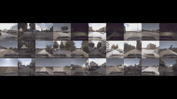
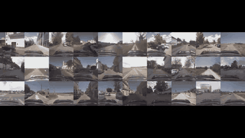

<div align="center">
<a href="https://github.com/user-attachments/assets/8be376b4-11b6-4e01-956a-d0d4f064d1db"></a><a href="https://github.com/user-attachments/assets/f1c99f96-e121-42d2-bed6-1045ec6b6669"></a>
<p>
<a href="https://openaccess.thecvf.com/content/CVPR2026/html/Elazab_CARD_A_Multi-Modal_Automotive_Dataset_for_Dense_3D_Reconstruction_in_CVPR_2026_paper.html" target="_blank" rel="noopener noreferrer"></a>
<a href="https://card.content.cariad.digital/" target="_blank" rel="noopener noreferrer"></a>
<a href="https://huggingface.co/CARD-Data" target="_blank" rel="noopener noreferrer"></a>
</p>
</div>

Download, load, and visualize CARD, a driving dataset for challenging road
topographies, including speed bumps, potholes, and off-road terrain.

Developed by Gasser Elazab at CARIAD SE as part of his PhD research.

## Install

Run the examples from this checkout. Python 3.11 or 3.12 is required.

```bash
uv sync --python 3.11 --extra torch --extra viz
source .venv/bin/activate
```

Alternatively, in an existing Python 3.11/3.12 environment:

```bash
python -m pip install ".[torch,viz]"
```

Use only `torch` for the dataloader, only `viz` for Rerun, or neither extra
for downloading alone.

The installed SDK includes the CARD loader and downloader packages. The loader
is a comprehensive, extensible reference implementation for CARD workflows.
It provides RGB, optional depth and labels, camera
calibration, poses, temporal neighbors, stereo metadata, synchronized
augmentation, batching, and optional ground-plane information. The loader 
prioritizes functionality and clarity over speed.

## Repository Layout

- [card_dataset](card_dataset): dataloader and synchronized augmentations.
- [download](download): Hugging Face download and file-size verification.
- [scripts](scripts): sample previews and split integrity checks.
- [src](src): the installed `card-viz` Rerun viewer.
- [splits](splits): training, validation, test, and small-sample image lists.
- [demo.ipynb](demo.ipynb): interactive depth and height examples.


## Download

The datasets are gated. Request access and accept the terms for each batch
you need under [CARD-Data on Hugging Face](https://huggingface.co/CARD-Data),
then authenticate with a read-enabled token from that same approved account:

```bash
hf auth login
python -m download.download_from_hf --output-dir ./data
```

To select batches, add `--repos` followed by any of `germany_batch1`,
`germany_batch2`, `germany_batch3`, or `italy`. Add `--check` to compare local
file sizes against the remote metadata without downloading.

Downloads preserve the split-compatible layout under one root:

```text
data/
    germany_2days/
    germany_batch2/
    germany_batch3/
    Nardo/
```

Use this `data/` directory as `base_root` when combining batches.

## Splits

Use the supplied files in [splits](splits):

| File | Use |
| --- | --- |
| [train.txt](splits/train.txt) | Training |
| [val.txt](splits/val.txt) | Validation |
| [test.txt](splits/test.txt) | Testing |
| [small_samples.txt](splits/small_samples.txt) | Quick inspection |

Each line is an image path relative to your dataset root. Set `base_root` to
the directory containing those paths. The split file itself can be an
absolute path or a path relative to `base_root`.

## Load Data

```python
from pathlib import Path
from torch.utils.data import DataLoader
from card_dataset.dataloader import UnifiedCardDataset, custom_collate_fn

dataset = UnifiedCardDataset.for_inference(
    base_root="/path/to/data",
    split_file=str(Path("splits/small_samples.txt").resolve()),
)
loader = DataLoader(dataset, batch_size=1, collate_fn=custom_collate_fn)
batch = next(iter(loader))
camera = batch["meta"]["center_cam"][0]
frame = batch[camera]["frames"][0]
print(frame["rgb"].shape)
```

Use `for_training` with `train.txt` for augmented training samples, or
`for_inference` with `val.txt` or `test.txt` for evaluation.
`for_training` configures training-oriented outputs and augmentations; it
does not make the reference loader optimized for training throughput, as
one would rarely needs all these modalities in training.

The loader reads precomputed NPZ depth. It does not generate depth from raw
LAZ files. Missing optional modalities are `None`. Existing archives with
unsupported keys or invalid dimensions, invalid paths, and timestamps outside
trajectory coverage raise errors instead of returning substitute data.

`lidar_sparse` reads `sparse_ground_truth`, which are the raw lidar,
 `depth_agg` normally projects `agg_depth/cam_1` camera-frame points.

### Ground Plane

Enable `load_ground_plane_info=True` to fit a local plane from wheel
ground-contact trajectories, or fixed ground-contact extrinsics when
trajectories are absent. Germany Batch 1 lacks the fixed ground-contact
extrinsics; its road plane uses the exported contact trajectories instead.

## Visualize

Open a sequence in Rerun:

```bash
card-viz /path/to/sequence --send-agg-depth-flag
```

For a headless local recording, add `--save output.rrd`. Use
`--load-dense-depth` to read metric depth maps from `depth/<camera>`.
Add `--dense-depth-dir my_depth` for another folder under the sequence, or
provide an absolute path. Missing optional camera depth exports are warned
about, not replaced by other predictions or aggregate points.

Save a sample's images and depth reprojections:

```bash
python -m scripts.viz_dataloader \
    --base_root "/path/to/data" \
    --split_file "$PWD/splits/small_samples.txt" \
    --idx 0 --load_ground_plane
```

See [Rerun options](src/README.md) for additional views. To check every sample
in a split, use:

```bash
python -m scripts.test_dataloader \
    --base_root "/path/to/data" \
    --split_file "$PWD/splits/val.txt" \
    --test_integrity
```

### Rerun Example

<div align="center">

https://github.com/user-attachments/assets/3e6019a9-7d3c-48ab-ae05-09f1a163695f

</div>

### Package Walkthrough

<div align="center">

https://github.com/user-attachments/assets/3b2118a0-1c44-49f4-817b-8f2e574c684e

</div>

### Dataset Setup & Examples

<div align="center">

</div>

## Notebook

Set these paths before running [demo.ipynb](demo.ipynb) in your Jupyter
environment:

```bash
export CARD_DATA_ROOT="/path/to/data"
export CARD_SPLIT_FILE="$PWD/splits/small_samples.txt"
```

The notebook requires precomputed depth files and both installation extras.
It also requires a Jupyter environment with `ipykernel`; select the SDK's
Python environment as the notebook kernel.

## License

- SDK: [MIT](LICENSE).
- Declared Python dependencies and their licenses: [Third-Party Notices](THIRD_PARTY_NOTICES.md).
- Germany data: [CC BY 4.0](https://creativecommons.org/licenses/by/4.0/).
- Italy data: [CC BY NC 4.0](https://creativecommons.org/licenses/by-nc/4.0/).

## Disclaimer

This Software / Contribution is unfinished, untested and is in particular
not in a state to be used in any productive or series context. It is provided
as a starting point for further development and any use requires extensive
checks, improvements and testing, for which exclusively the user integrating
this OSS shall be responsible.

## Citation

```bibtex
@InProceedings{Elazab_CARD_CVPR2026,
    author    = {Elazab, Gasser and Neuhaus, Frank and Ko{\ss}, Tilman and Splietker, Malte and Date, Aditya and Unterreiner, Michael and Jansen, Maximilian and Hellwich, Olaf},
    title     = {CARD: A Multi-Modal Automotive Dataset for Dense 3D Reconstruction in Challenging Road Topography},
    booktitle = {Proceedings of the IEEE/CVF Conference on Computer Vision and Pattern Recognition (CVPR)},
    month     = {June},
    year      = {2026},
    pages     = {17820--17830}
}
```

Contact: **gasser.elazab@cariad.technology**