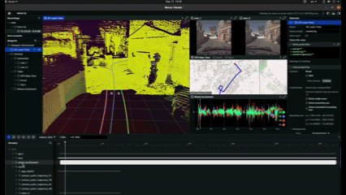

# CARD SDK
<div align="center">


</div>


<div align="center">
Welcome to the SDK of CARD, which is a driving dataset dedicated to the worse road topographies that are rarely recorded, such as speed bumps, potholes, and off-road conditions. This repo is the toolkit designed for easy access, loading, and visualization of the CARD dataset. This repository provides the essential tools to get you started:
</div>

📂 Repository Overview
1. Download Utilities (download/)

download/download_from_hf.py: A robust script to download specific batches (e.g., Germany, Italy) or the entire dataset directly from Hugging Face.

2. Core SDK (card_dataset/)

card_dataset/dataloader.py: The main generalizable dataloader. Use this to integrate CARD data into your Python pipelines with synchronized sensor and trajectory data.

3. Visualization & Scripts (scripts/ & src/)

src/rerun_vis.py (installed as card-viz): The primary interactive 3D visualizer powered by Rerun.

scripts/viz_dataloader.py: A helper script to visualize and verify the raw output directly from the dataloader.

## 🚀 Getting Started

### Quick Start (SDK)

1. Use Python 3.10–3.12 (recommended).
2. Create and activate a virtual environment:
	```bash
	python3 -m venv .venv
	source .venv/bin/activate
	```
3. Install the SDK so the `card-viz` command is available:
	```bash
	pip install .
	# Optional extras for dataloader and plotting:
	# pip install .[torch,viz]
	```

### 1. Prerequisites & Login

Before downloading the datasets, you must authenticate with Hugging Face.

**Install the library:**
```bash
pip install huggingface_hub
```

**Log in:**  
Run the following command and enter your Hugging Face Access Token (make sure the token has read permissions):
```bash
huggingface-cli login
```

### 2. Downloading the Data

We provide a utility script located at `download/download_from_hf.py` to handle large dataset downloads efficiently.

**Option A: Download Everything (Recommended)**  
To download the entire CARD dataset (Germany and Italy batches) to a `data/` folder:
```bash
python download/download_from_hf.py --output-dir ./data
```

**Option B: Download Germany Data Only (Commercial-Friendly License)**  
If you only need the Germany datasets (Batch 1, 2, and 3), you can filter the download using the `--repos` flag:
```bash
python download/download_from_hf.py --output-dir ./data --repos germany_batch1 germany_batch2 germany_batch3
```
*Note: You can replace the repository keys above to download any specific combination you need (e.g., just `--repos italy`).*

---

## 🧭 Visualization

Once installed, you can use the card-viz command directly from your terminal to inspect datasets.

```bash
card-viz <path-to-seq> --send-agg-depth-flag
```
You should see the rerun visualizer like this:



### Visualizing the output from the dataloader

- Visualizer using `scripts/viz_dataloader.py` projecting depth from image at (t) to (t-1) and (t+1):

	```bash
	python -m scripts.viz_dataloader \
		--base_root "<path to data root>" \
		--split_file "val_all_data_clean.txt" \
		--idx 68 \
		--load_ground_plan
	```

- Data integrity checker using `scripts/test_dataloader.py` (useful when you have the full dataset and want to verify a given split):

	```bash
	python -m scripts.test_dataloader \
		--base_root "<path to data root>" \
		--split_file "val.txt" \
		--idx 6288 \
		--load_ground_plane \
		--test_integrity
	```

---

### 💡 Utility Tips

- **Test Run:** Not sure if your setup works? Add `--test` to download only the metadata files (fast).
	```bash
	python download/download_from_hf.py --output-dir ./data --test
	```
- **Verify Integrity:** If you suspect a corrupted download, use `--check` to verify your local files against the remote server without re-downloading.
	```bash
	python download/download_from_hf.py --output-dir ./data --check
	```

---


### An example of data sample of a speed bump. 


---

## 📄 License & Property Notice

**Dataset License:**
- Germany data: [CC BY 4.0](https://creativecommons.org/licenses/by/4.0/)
- Italy data: [CC BY NC 4.0](https://creativecommons.org/licenses/by-nc/4.0/)

**SDK License:**
- MIT License

---


## 📚 Citation

If you use CARD or the SDK in your research, please cite:

> [Add your citation here]

---

## 📬 Contact

For questions, reach out to: **gasser.elazab@cariad.technology**


