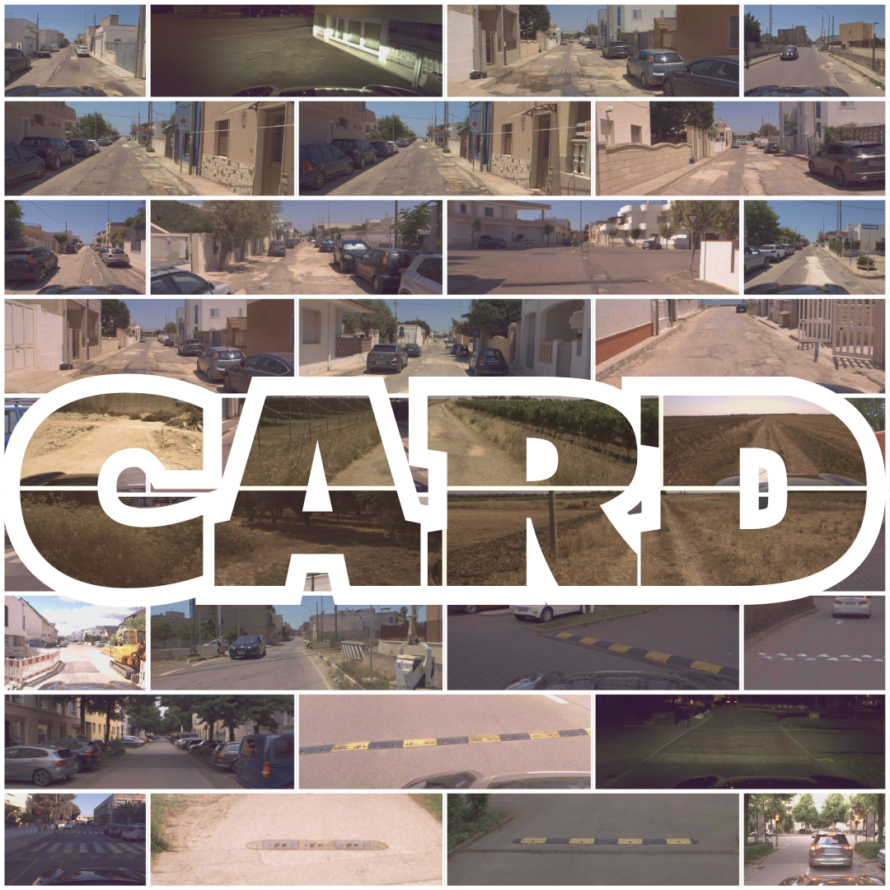
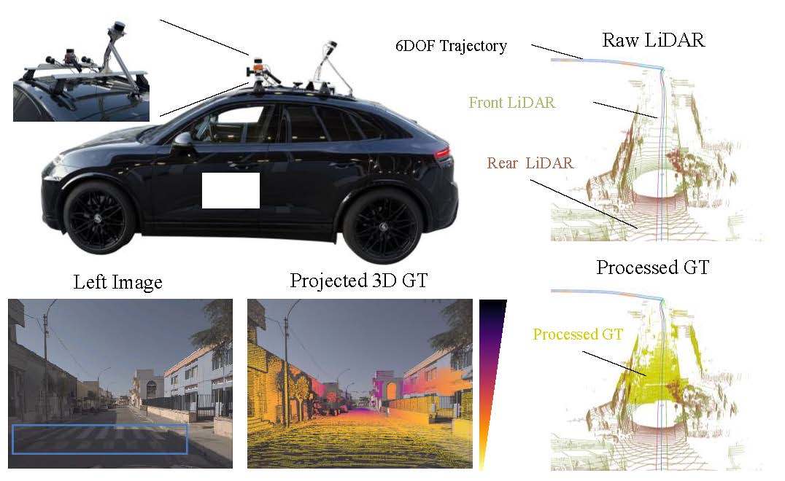

# CARD SDK

<div align="center">

<p>
<a href="https://openaccess.thecvf.com/content/CVPR2026/html/Elazab_CARD_A_Multi-Modal_Automotive_Dataset_for_Dense_3D_Reconstruction_in_CVPR_2026_paper.html" target="_blank" rel="noopener noreferrer"></a>
<a href="https://card.content.cariad.digital/" target="_blank" rel="noopener noreferrer"></a>
<a href="https://huggingface.co/CARD-Data" target="_blank" rel="noopener noreferrer"></a>
</p>
</div>

Download, load, and visualize CARD, a driving dataset for challenging road
topographies, including speed bumps, potholes, and off-road terrain.

Developed by Gasser Elazab at CARIAD SE as part of his PhD research.

## Install

Run the examples from this checkout. Python 3.11 or 3.12 is required.

```bash
uv sync --python 3.11 --extra torch --extra viz
source .venv/bin/activate
```

Alternatively, in an existing Python 3.11/3.12 environment:

```bash
python -m pip install ".[torch,viz]"
```

Use only `torch` for the dataloader, only `viz` for Rerun, or neither extra
for downloading alone.

## Repository Layout

- [card_dataset](card_dataset): dataloader and synchronized augmentations.
- [download](download): Hugging Face download and file-size verification.
- [scripts](scripts): sample previews and split integrity checks.
- [src](src): the installed `card-viz` Rerun viewer.
- [splits](splits): training, validation, test, and small-sample image lists.
- [demo.ipynb](demo.ipynb): interactive depth and height examples.

## Download

Authenticate with a Hugging Face token that has read access, then download:

```bash
hf auth login
python -m download.download_from_hf --output-dir ./data
```

To select batches, add `--repos` followed by any of `germany_batch1`,
`germany_batch2`, `germany_batch3`, or `italy`. Add `--check` to compare local
file sizes against the remote metadata without downloading.

Downloads preserve the split-compatible layout under one root:

```text
data/
    germany_2days/
    germany_batch2/
    germany_batch3/
    Nardo/
```

Use this `data/` directory as `base_root` when combining batches.

## Splits

Use the supplied files in [splits](splits):

| File | Use |
| --- | --- |
| [train.txt](splits/train.txt) | Training |
| [val.txt](splits/val.txt) | Validation |
| [test.txt](splits/test.txt) | Testing |
| [small_samples.txt](splits/small_samples.txt) | Quick inspection |

Each line is an image path relative to your dataset root. Set `base_root` to
the directory containing those paths. The split file itself can be an
absolute path or a path relative to `base_root`.

## Load Data

```python
from pathlib import Path
from torch.utils.data import DataLoader
from card_dataset.dataloader import UnifiedCardDataset, custom_collate_fn

dataset = UnifiedCardDataset.for_inference(
    base_root="/path/to/data",
    split_file=str(Path("splits/small_samples.txt").resolve()),
)
loader = DataLoader(dataset, batch_size=1, collate_fn=custom_collate_fn)
batch = next(iter(loader))
camera = batch["meta"]["center_cam"][0]
frame = batch[camera]["frames"][0]
print(frame["rgb"].shape)
```

Use `for_training` with `train.txt` for augmented training samples, or
`for_inference` with `val.txt` or `test.txt` for evaluation.

The loader reads precomputed NPZ depth; it does not generate depth from raw
LAZ files. Missing optional modalities are `None`. Corrupt files and invalid
image paths raise errors.

Augmented training is intended for depth learning. Bounding-box labels are
omitted when augmentations are enabled; detection-label augmentation is not
implemented.

Ground-plane data is optional (`load_ground_plane_info=True`). Germany
Batch 1 lacks wheel-contact calibration, so its plane is an estimate, marked
`ground_plane_info["source"] == "vehicle_height_estimate"`, not ground truth.
Other batches' `_ground` and `_Ground` key spellings are matched
case-insensitively.

## Visualize

Open a sequence in Rerun:

```bash
card-viz /path/to/sequence --send-agg-depth-flag
```

Save a sample's images and depth reprojections:

```bash
python -m scripts.viz_dataloader \
    --base_root "/path/to/data" \
    --split_file "$PWD/splits/small_samples.txt" \
    --idx 0 --load_ground_plane
```

See [Rerun options](src/README.md) for additional views. To check every sample
in a split, use:

```bash
python -m scripts.test_dataloader \
    --base_root "/path/to/data" \
    --split_file "$PWD/splits/val.txt" \
    --test_integrity
```

### Rerun Example

<div align="center">

https://github.com/user-attachments/assets/3e6019a9-7d3c-48ab-ae05-09f1a163695f

</div>

### Package Walkthrough

<div align="center">

https://github.com/user-attachments/assets/3b2118a0-1c44-49f4-817b-8f2e574c684e

</div>

### Dataset Setup & Examples

<div align="center">

</div>

## Notebook

Set these paths before running [demo.ipynb](demo.ipynb) in your Jupyter
environment:

```bash
export CARD_DATA_ROOT="/path/to/data"
export CARD_SPLIT_FILE="$PWD/splits/small_samples.txt"
```

The notebook requires precomputed depth files and both installation extras.

## License

- SDK: [MIT](LICENSE).
- Germany data: [CC BY 4.0](https://creativecommons.org/licenses/by/4.0/).
- Italy data: [CC BY NC 4.0](https://creativecommons.org/licenses/by-nc/4.0/).

## Disclaimer

This Software / Contribution is unfinished, untested and is in particular
not in a state to be used in any productive or series context. It is provided
as a starting point for further development and any use requires extensive
checks, improvements and testing, for which exclusively the user integrating
this OSS shall be responsible.

## Citation

```bibtex
@InProceedings{Elazab_CARD_CVPR2026,
    author    = {Elazab, Gasser and Neuhaus, Frank and Ko{\ss}, Tilman and Splietker, Malte and Date, Aditya and Unterreiner, Michael and Jansen, Maximilian and Hellwich, Olaf},
    title     = {CARD: A Multi-Modal Automotive Dataset for Dense 3D Reconstruction in Challenging Road Topography},
    booktitle = {Proceedings of the IEEE/CVF Conference on Computer Vision and Pattern Recognition (CVPR)},
    month     = {June},
    year      = {2026},
    pages     = {17820--17830}
}
```

Contact: **gasser.elazab@cariad.technology**